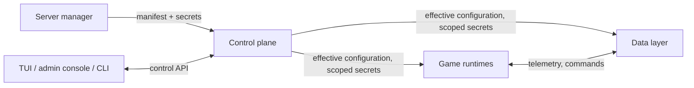

# Architecture

Valhallowed (VHD): what it is, the rules it is built under, and the decisions
still open. Terms mean exactly what [glossary.md](glossary.md) says; the name
and its rules live in [brand.md](brand.md). The [diagrams](diagrams/README.md)
draw this document; where they disagree, this document wins.

## Target

Someone with only Docker installs a Valheim dedicated server that carries the
VHD plugin, telemetry, governed in-game commands and the web map. They write
one manifest and, optionally, a secrets file. Everything else is defaulted,
derived or generated. The host is x86-64, because the dedicated server ships for
nothing else: a Linux machine, or Docker Desktop on Windows or macOS with an
Intel or AMD processor.

## Ground rules

Decided. Each one binds every later decision. A rule keeps its number for
good, and an open decision's number is never reused.

| # | Rule | Why |
|---|---|---|
| G1 | **Public from the first commit.** Code, history, decisions and images are public. | Contributors see the whole record, and nothing depends on code they cannot read. |
| G2 | **No install is special.** The maintainers' own servers run the same releases, with the same settings, as everyone else's: no private code path, image, setting or override. | One product, one test surface. A setting only one install needs is a gap in the settings. |
| G3 | **Bring your own, with complete defaults.** Every external dependency has a built-in default that works with no setup, and a typed way to substitute your own. | An existing database or chat service is a setting, not a fork. |
| G4 | **Release pipeline first.** The pipeline exists and passes before any feature lands. Every feature ships through it. | Capability stays tested as features ship. |
| G5 | **Distribution:** images on a public registry (G10), the plugin as a release artifact. Builds run locally and in GitHub Actions from one definition. | Several ways to consume it, one way to build it. |
| G6 | **One strict point of ingress,** in three parts: secrets, control plane, game runtimes (below). | Validate once at the boundary. Internal logic never sees raw input, and failures stay in their own domain. |
| G7 | **License: MIT.** | The simplest terms for the people who host it and the people who contribute. |
| G8 | **Name:** the product is Valhallowed, short form VHD, at valhallowed.com. | One name across code, docs and marketing. |
| G9 | **Every port, address and resource allocation is a default.** Each has a sensible default and can be changed in the manifest. | Hosts differ. Defaults make the first install work; overrides make every install fit. |
| G10 | **Registry: GHCR.** Images publish to the GitHub Container Registry. | The workflow's own token publishes, so no registry secret is stored anywhere, and public images cost nothing to host or pull. |
| G11 | **Identifiers.** Repos and images live in the `valhallowed` GitHub org: repo `valhallowed/valhallowed`, images `ghcr.io/valhallowed/<component>`, CLI `vhd`. | Image paths carry the owner, so they never have to change. |
| G12 | **Build once, promote by tag.** Only CI on `main` builds and pushes images. A version tag applies to images already in the registry and never rebuilds them. | A release is exactly the candidate that soaked, and nothing reaches the registry from a workstation. |

## The model

### Secrets

- **Closed key set.** The schema defines every permitted key name. An unknown
  key is rejected, so a misspelt key fails at the boundary instead of silently
  doing nothing.
- **Format check per key.**
- **Optional by default.** An absent secret turns off the capability that needs
  it, and status says why. If the manifest explicitly enables a capability and
  its secret is missing, the manifest is rejected.
- **Internal secrets are generated, never asked for:** the bundled database's
  password and every service-to-service token. The server manager supplies
  only what cannot be generated: world passwords and credentials for outside
  services (chat relay, LLM provider, their own database).
- **Least privilege.** Each child receives only the secrets it needs. No child
  reads the secrets source. Status shows set, unset or invalid, never a value.
- **Kept apart from the manifest,** so the manifest can be committed and shared.

### Control plane

Owns ingress, reconcile, child lifecycle, operator actions and status.

- **Manifest.** Strongly typed, with a versioned schema. The one schema
  produces validation, defaults, each child's configuration and the
  user-facing settings reference, so the reference cannot drift from the code.
- **Reconcile.** Manifest plus defaults produce one effective configuration
  (a generation). All or nothing: an invalid manifest on hot reload is rejected
  and the last good generation keeps running. Reconcile reports what was set,
  what defaulted and what that implies.
- **Change cost.** Every setting is classed as live, service restart or
  game-server restart. A change that needs a game-server restart waits as
  pending while players are online.
- **Host check.** At first start and on every reconcile, the control plane
  compares what the manifest asks for with what the host has: ports, memory
  and CPU per world, disk for worlds and backups. A shortfall is a warning in
  status, never a silent failure. A port already taken on the host stops only
  the world that needs it.
- **Interfaces.** One control API. The TUI, the admin console and the CLI are
  its clients. The admin console listens locally unless the manifest opens it.
  They cover manifest errors, hot reload, status, world import and export,
  backups and logs.
- **Failure domain.** Needed to start or change an install, not to keep it
  running. If it stops at steady state, children keep running on the last good
  generation.
- **Status reports world truth, not container health:** whether the world
  loaded, and its object count against the save.

### Game runtimes

- **The child runs the game; the control plane sets policy.** A runtime runs
  the Valheim dedicated server, BepInEx and the plugin on what the control
  plane hands it. Updates, backups, schedules, world import and export, and
  restart gating belong to the control plane.
- **Children read only the effective configuration.** Generated files, such as
  the plugin's BepInEx config, are never edited by hand.
- **Capabilities are independent.** Telemetry, in-game commands, chat relay,
  assistant, web map and sign-in each switch on separately and declare what
  they depend on. A failure in one degrades that capability only.

### Data layer (placement open, O2)

Telemetry intake, persistence, the command broker, the chat relay, the web map
and the database. Three rules hold: only the broker creates a command, only the
plugin executes one, and markers and journal entries are records, never
commands.

### Internal boundaries

The ingress is the one way in from outside. Every crossing inside VHD is a
boundary, and every boundary follows one standard:

- One typed contract, versioned with the release.
- The receiving side validates.
- One owner.
- A stated failure behaviour. Observations fail soft: drop and count, and the
  game never waits. Actions fail closed: refuse and record.

| # | Boundary | Crosses | Contract | On failure |
|---|---|---|---|---|
| I0 | Ingress | Manifest, secrets, operator actions into the control plane | Manifest schema, secrets key list, control API | Reject whole; the last good generation keeps running |
| B1 | Control plane → children | Effective configuration and scoped secrets; status back | Generation schema | The child keeps its last good generation |
| B2 | Plugin → intake | Telemetry events | Event schema | Fail soft |
| B3 | Broker ↔ plugin | Commands and their outcomes | Command verbs, limits, idempotency key | Fail closed |
| B4 | Services → database | Reads and writes | Schema owned by the data layer; one role per service | The capability degrades; nothing else migrates the schema |
| B5 | Plugin → world render | Map export file | Export file format | The web map keeps its last good render |
| B6 | Web map → data | Reads, record writes, chat sends | Read-only role, record constraints, chat-scoped token through the broker | The web map stays read-only |
| B7 | Assistant → LLM provider | World digest and question; answer | Provider adapter with timeout and budget | The assistant reports itself unavailable |
| B8 | Chat relay ↔ chat service | Events out; commands in | Adapter; inbound authors allow-listed; commands go through the broker | The relay switches off; the game is unaffected |
| B9 | Web map ↔ Steam | Sign-in | OpenID; server-side sessions | The web map stays public and read-only |
| B10 | Players → game runtime | Game traffic and chat lines | Game protocol (not ours); chat commands parsed and rate-limited by the plugin, issued through the broker | The command is refused and audited |
| B11 | Players → web map | Web requests | Web map API schema; identity from the session only | The request is rejected |

### Exposure

An exposure profile sets what an install opens beyond the host. Every port and
address in a profile is a default (G9).

| Profile | Game | Web map | Sign-in |
|---|---|---|---|
| LAN (default) | Reachable | Plain HTTP on the LAN | Works for LAN players; warns that sessions are unencrypted |
| Public, direct | Open to the internet | Plain HTTP, open to the internet | Works for everyone; same warning, plus a browser warning on a player's first visit |
| Public with TLS | Open to the internet | HTTPS through bundled TLS or the server manager's own proxy (O12) | Works for everyone, with no warnings |
| Game only | Reachable | Off | Off |

In every profile the admin console stays on loopback unless the manifest opens
it, and no data-layer service or database gets a host port.

A profile sets what the install opens on the host. Whether that reaches the
internet is up to the host's network: behind a home router it takes a port
forward, and on a server with its own public address everything the LAN profile
opens is public unless a firewall closes it.

## Lanes

Follows from G2 and G4. Building VHD, developing it and running it can share one
host without touching each other. The registry is the boundary between building
the product and running it.

| Lane | Runs | Isolation |
|---|---|---|
| Build | Source to plugin artifact and images | No running state |
| Dev | A full install of the product with a throwaway world, including its own game server for plugin work | Its own install: project name, network, volumes and ports. Never touches a consumer install |
| Consumer | Released tags pulled from the registry, nothing else | A normal install |

## Releases

Follows from G4 and G12.

| Channel | Image tags | Made by |
|---|---|---|
| Commit | `sha-<commit>`, `edge` | Every merge to `main`: CI builds and pushes the images |
| Candidate | `X.Y.Z-rc.N` | Tag `vX.Y.Z-rc.N`: promotes that commit's images |
| Release | `X.Y.Z`, `latest` | Tag `vX.Y.Z`: promotes the newest candidate on the same commit, and is refused if there is none |

- **Images record the commit they were built from.** Versions exist only as
  tags, which is what lets a tag promote an image without rebuilding it.
- **Every channel passes acceptance before it publishes:** a clean runner
  installs it from the registry, anonymously. An image that was never pushed,
  or is not public, fails there, not on someone's server.
- **Candidates and releases attach `compose.yaml`,** with every image pinned by
  digest, and `SHA256SUMS`.
- **Three gates.** The merge gate: every check passes before a merge to
  `main`. The candidate gate: acceptance passes on the registry images,
  including against the newest game build, before a candidate tag. The release
  gate: the candidate ran on the candidate channel with no open blockers before
  the release tag.

## Delivery order

1. **Charter.** Settle the open decisions that shape the skeleton (O1–O6) and
   the first version of the manifest schema.
2. **Pipeline and walking skeleton.** Build, publish, install from the registry
   on a clean host, and see one live player on the web map.
3. **Acceptance material.** Recorded sessions, world saves and contracts that
   every capability must keep, synthesized or anonymized.
4. **Capabilities, one release at a time,** each passing its acceptance
   material.

## Game facts

What any design here must respect about the game.

- The dedicated server ships for x86-64 only, so every VHD image is
  `linux/amd64`. An ARM host is not supported.
- Two save formats are live: a single pre-1.0 file and the 1.0+ chunked
  directory. Save numbers wrap; the game picks the newest by modification time.
- The world-name setting must equal the save name, or the server creates a new,
  empty world.
- Harmony binds patches by name. After a game patch, a patch can apply and then
  throw, so a healthy container does not mean a loaded world.
- Player names are client-supplied and not unique. Identity comes only from
  same-object pairs (beds, tombstones, wards).
- Prefab names must be verified against live world data, never assumed.
- A save parser fails closed outside the version range it was validated
  against.
- The plugin builds against stock, unmodified game assemblies plus BepInEx and
  Harmony, with no publicizer step. The dedicated-server download carries every
  assembly it references (`assembly_valheim`, `assembly_utils`, `Splatform`,
  `UnityEngine`, `UnityEngine.CoreModule`), so a build stage fetches them and
  the plugin builds anywhere, including GitHub Actions. Game files never enter
  an image or a release.

## Open decisions

| # | Question | Options | Lean |
|---|---|---|---|
| O1 | How does the control plane control its children? | Single container, control plane as process supervisor · control plane drives containers through the Docker socket · cooperative: compose owns the containers, the control plane publishes generations, children reload in place or exit to be restarted | Cooperative: the only option that keeps both isolation and least privilege. Lifecycle actions such as world import need a stop-and-wait step. |
| O2 | Where does the data layer sit? | Children of the control plane · inside the control plane | Children. It carries heavy traffic and fails more often; the control plane stays small and always up. |
| O3 | Worlds per install | One install runs many worlds · one install per world | Many worlds. A server manager with several worlds runs one install, with no extra tooling to keep several installs in step. |
| O4 | Game runtime image | Own thin image · built on `lloesche/valheim-server` | Own image. lloesche's environment settings would be a second ingress under ours, and its backups and updates duplicate control-plane work. lloesche stays a reference. |
| O5 | Repo shape | One repo, one version, one CI · one repo per component | One repo. Cross-component changes land together, and one version describes a release. |
| O6 | Manifest format and upgrade path | — | One file with a versioned schema. A renamed key migrates automatically or fails with a clear message. |
| O11 | Languages for the control plane and the services | Python for the data layer and TypeScript for the web map · choose fresh | Python and TypeScript; the control plane is open. The plugin's stack is fixed by the game. |
| O12 | TLS for a public web map | Plain HTTP with warnings · bundled TLS with automatic certificates, for a hostname or a bare public IP · the server manager's own reverse proxy | Offer all three. Bundled TLS is the recommended public profile: Let's Encrypt issues certificates for bare IP addresses since January 2026, so it needs no domain, only port 80 or 443 reachable for the challenge. |
| O13 | Default resources per world | Fixed defaults · sized from the host at first start | Fixed defaults, set from a measurement under player load. One idle-hours reading put a game server at 1.9–2.8 GiB of memory. The host check warns when the host falls short. |
