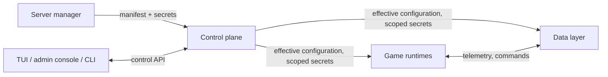

# Architecture

Valhallowed (VHD): what it is, the rules it is built under, and the decisions
still open. Terms mean exactly what [glossary.md](glossary.md) says; the name
and its rules live in [brand.md](brand.md). It describes VHD as designed; the
[board](https://github.com/orgs/valhallowed/projects/1) shows what is built.
The [diagrams](diagrams/README.md) draw it, and say how they treat a part
built short of the design.

## Target

Someone with only Docker installs a Valheim dedicated server that carries the
VHD plugin, telemetry, governed in-game commands and the web map. They write one
manifest and, optionally, a secrets file. Everything else is defaulted, derived
or generated. The host is x86-64 (§ Game facts): a Linux machine, or Docker
Desktop on Windows or macOS with an Intel or AMD processor. Acceptance runs on
Linux, so Docker Desktop and rootless Docker are goals no check covers.

## Ground rules

Decided. Each one binds every later decision. A rule keeps its number for
good, and an open decision's number is never reused. A rule settled from an
open decision names it.

| # | Rule | Why |
|---|---|---|
| G1 | **Public from the first commit.** Code, history, decisions and images are public. | Contributors see the whole record, and nothing depends on code they cannot read. |
| G2 | **No install is special.** The maintainers' own servers run the same releases, with the same settings, as everyone else's: no private code path, image, setting or override. | One product, one test surface. A setting only one install needs is a gap in the settings. |
| G3 | **Bring your own, with complete defaults.** Every external dependency has a built-in default that works with no setup, and a typed way to substitute your own. | An existing database or chat service is a setting, not a fork. |
| G4 | **Release pipeline first.** The pipeline exists and passes before any feature lands. Every feature ships through it. | Capability stays tested as features ship. |
| G5 | **Distribution:** images on a public registry (G10), the plugin as a release artifact. Builds run locally and in GitHub Actions from one definition. | Several ways to consume it, one way to build it. |
| G6 | **One way in.** Settings, secrets and operator actions enter only through the control plane and are validated there. Nothing past it reads raw input. | Validate once at the ingress. Internal logic never sees raw input, and failures stay in their own domain. |
| G7 | **License: MIT.** | The simplest terms for the people who host it and the people who contribute. Settled from O9. |
| G8 | **Name:** the product is Valhallowed, short form VHD, at valhallowed.com. | One name across code, docs and marketing. |
| G9 | **Every port, address and resource allocation is a default.** Each has a sensible default and can be changed in the manifest. That covers what meets the host: published ports, addresses, and each world's resources. Wiring inside an install, between VHD's own containers, is fixed. | Hosts differ. Defaults make the first install work; overrides make every install fit. |
| G10 | **Registry: GHCR.** Images publish to the GitHub Container Registry. | The workflow's own token publishes, so no registry secret is stored anywhere, and public images cost nothing to host or pull. Settled from O7. |
| G11 | **Identifiers.** Repos and images live in the `valhallowed` GitHub org: repo `valhallowed/valhallowed`, images `ghcr.io/valhallowed/<component>`, CLI `vhd`. | Image paths carry the owner, so they never have to change. Settled from O10. |
| G12 | **Build once, promote by tag.** Only CI on `main` builds and pushes images. A version tag applies to images already in the registry and never rebuilds them. | A release is exactly the candidate that soaked, and nothing reaches the registry from a workstation. |
| G13 | **Compose owns the containers; the running control plane holds no Docker socket.** The control plane validates, reconciles and publishes each generation; a child applies it in place, or exits and Docker restarts it under the policy Compose set. A change to the containers themselves (a world added or removed, a published port, a resource limit, the VHD version) waits as a pending change until the server manager runs `vhd apply`, which acts with the server manager's own access to Docker. | A Docker socket is root on the host, so whatever took over the control plane, or an admin console the manifest opened, would take the host with it. Container changes are rare, and they cost one host command. Settled from O1. |
| G14 | **The data layer runs as children,** one container per service, never inside the control plane. | It carries the heavy traffic and fails more often; the control plane stays small and always up. Settled from O2. |
| G15 | **One install runs many worlds,** each in its own game runtime, with its own world ports and resource limits. | A server manager with several worlds runs one install, with no extra tooling to keep several installs in step. A crash, a restart or a memory limit stays inside its world. Settled from O3. |
| G16 | **VHD builds its own game runtime image:** the supervisor, BepInEx and the plugin on a pinned base. SteamCMD and the dedicated server download into the install at first start, and the server again on each update. Neither is pinned: Valve updates SteamCMD in place, and the server is the game's newest build, which world truth guards. `lloesche/valheim-server` is a reference, not a base. | Its environment settings would be a second ingress under ours (G6), and its backups and updates duplicate control-plane work. Downloading SteamCMD keeps every Valve and Iron Gate file out of a public image. Settled from O4. |
| G17 | **One repo, one version, one CI.** Every component lives in `valhallowed/valhallowed` and ships in the same release. | Cross-component changes land together, and one version describes a release. Settled from O5. |
| G18 | **The manifest and the secrets file are TOML 1.0,** each checked against a versioned JSON Schema in [`schema/`](../schema/). Each file declares its schema version. A renamed key migrates automatically or fails with a message that names the new key. | TOML has one specification, explicit types and no meaningful indentation, so a value means what it looks like. JSON Schema is language-neutral: editors, the control plane and the settings reference read the same file. Settled from O6. |
| G19 | **Languages:** Python for the control plane, the data layer and the game runtime's supervisor; TypeScript for the web map and the admin console's front end; C# for the plugin. | One backend language, so the generation's producer and its consumers share a toolchain and its tests. The game fixes the plugin's language. Settled from O11. |

## The model

### Secrets

- **Closed key set.** The secrets schema defines every permitted key name. An
  unknown key is rejected, so a misspelt key fails at the ingress instead of
  silently doing nothing.
- **Format check per key.**
- **Optional by default.** An absent secret turns off the capability that needs
  it, and status says why. If the manifest explicitly enables a capability and
  its secret is missing, the manifest is rejected.
- **Internal secrets are generated, never asked for:** each service's password
  for the bundled database, and every service-to-service token. The server manager supplies
  only what cannot be generated: world passwords and credentials for outside
  services (chat relay, LLM provider, their own database).
- **Least privilege.** Each child receives only the secrets it needs. No child
  reads the secrets source. Status shows set, unset or invalid, never a value.
  One secret escapes this: the dedicated server takes a world's password only on
  its command line, where any user on the host can read it from the process
  list.
- **Kept apart from the manifest,** in a file of their own (G18), so the
  manifest can be committed and shared.

### Control plane

Owns ingress, reconcile, child lifecycle, operator actions and status.

- **Manifest.** Strongly typed, with a versioned schema (G18). With the secrets
  schema, it produces validation, defaults, each child's configuration and the
  user-facing settings reference, so the reference cannot drift from the code.
  Every setting records its change cost and what applies it.
- **Setting names.** Keys are snake_case. A capability's settings sit in a
  table named for it (`web_map`, `chat_relay`); a world's sit under
  `world.<save name>`. A secret's key mirrors the manifest path it belongs to
  (`world.<save name>.password`). A port or a count is an integer; any other
  quantity is a string that carries its unit (`15m`, `6GiB`).
- **Reconcile.** The manifest, secrets and defaults produce one effective
  configuration (a generation). All or nothing: an invalid manifest on hot
  reload is rejected and the last good generation keeps running. Reconcile
  reports what was set, what defaulted and what that implies.
- **Change cost.** Every setting is classed as live, service restart or
  game-server restart. A change that needs a game-server restart waits as
  pending while players are online, unless the server manager applies it now
  after being shown which worlds and how many players it disconnects. The
  override is recorded with the change.
- **Applying a change.** The control plane publishes a generation; each child it
  affects reloads it in place, or exits and Docker restarts it. A change to the
  containers themselves waits as pending until the server manager runs
  `vhd apply` (G13): a run of `vhd`, the one-shot container that only the
  server manager starts and the only one that gets the Docker socket, for that
  run. `vhd import` and `vhd export` are runs of it too, and hold the same lock
  as `vhd apply`, so no two of them interleave. `vhd apply` validates the
  manifest, keeps a game-server restart pending while players are online unless
  the server manager confirms it, renders the install's compose file from the
  current generation and the release's `compose.yaml`, and has Compose recreate
  only the containers whose definition changed. `vhd apply --disconnect-players`
  is that confirmation. A world whose runtime has stopped reporting counts as
  occupied, since status cannot vouch for it. A player who joins in the seconds
  between that check and Compose recreating a container is disconnected; a
  change a runtime applies in place has no such window. The Compose it runs is
  the one in the control plane's image, so the host's own Compose only has to
  start the one-shot.
- **Delivering a generation.** The control plane writes each child's
  generation, and the secrets scoped to it, into that child's own directory of
  one generations volume. The directory, like the child's Compose service, is
  named for it: a world's save name in lower case with a short hash, since
  save names allow characters Compose names do not, and a data-layer
  service's own name. Each child mounts only its
  own directory, read-only (a volume subpath, which needs Docker Engine 26), so
  it can read no other child's secrets. The secrets go first and the generation
  second, and a child acts on neither until both carry the same generation
  (B1). A world's directory is also keyed by its port, so when `vhd apply`
  moves a world to a new port only the new container reads that change. If
  Compose fails partway, `vhd apply` brings the install back on the compose
  file Compose last ran successfully, which it replaces only once a run
  succeeds; a moving world's old directory stays as it was until then.
- **Running as.** The control plane runs as the install folder's owner, whom
  `vhd apply` reads from the folder, so the secrets file can stay readable by
  its owner alone. Every other child runs as VHD's own unprivileged user.
- **Host check.** At first start and on every reconcile, the control plane
  compares what the manifest asks for with what the host has: memory and CPU
  per world, disk for worlds and backups. A shortfall is a warning in status,
  never a silent failure. Ports show where they are published: a port already
  taken on the host fails that `vhd apply`, and Compose names it. An install
  that has run comes back as it ran: a world added on that port never starts
  and the rest keep running, and a world moved to it restarts on its old port.
  A first `vhd apply` that fails removes the containers it created.
- **Interfaces.** One control API. The TUI, the admin console and the CLI,
  `vhd`, are its clients, and cover manifest errors, hot reload, status, world
  import and export, backups and logs. The CLI runs from the control plane's
  image, so a host needs only Docker. The control API answers on a Unix socket
  in a volume only the control plane and `vhd` mount, so no child and no network
  reaches it. It serves status (`GET /status`) and an operator action,
  a restore (`POST /restore`, `vhd restore`): validated against its contract,
  then against the install, which takes only a backup the world's runtime has
  reported (`vhd backups` lists them). A refusal changes nothing. World import
  and export run through the game runtime's image instead, which `vhd import`
  and `vhd export` start with the server manager's access to Docker (§ Game
  runtimes); an import asks for its restore by writing it into the control
  plane's state, as the control API does. While the control plane's volume stays
  busy, with `vhd apply` or the control plane's own pass, an operator action is
  refused rather than kept waiting past its request's time. Children report
  status to a separate listener on the install network that accepts status and
  nothing else, and only from the reporting child's own container: it trusts
  source addresses, which holds because no child has the capability to forge
  one. The admin console will put the control API on the host's loopback unless
  the manifest opens it, once its authentication is settled (O14).
- **Failure domain.** Needed to start or change an install, not to keep it
  running. If it stops at steady state, children keep running on the last good
  generation.
- **Status reports world truth, not container health:** whether the world
  loaded, and its object count against the save. A world whose runtime has not
  reported for three of its reporting intervals shows as unknown, never as its
  last state. A world's status also names its backups, and why its runtime
  could not take or keep one. A data-layer service reports starting, running
  or failing, with the reason, and intake its counts of events taken and
  dropped.

### Game runtimes

- **The child runs the game; the control plane sets policy.** A runtime runs
  the Valheim dedicated server, BepInEx and the plugin on what the control
  plane hands it; its supervisor reads the generation, installs and updates
  the server, starts and stops it, and reports status. Backups, updates,
  restores, and world import and export are the control plane's to set and to
  ask for, and each world's runtime carries them out on its own world only. It
  already holds the world's data volume and sees when a save is complete, and
  it reaches no other world's saves; the control plane would otherwise mount
  every world's saves and carry their traffic, which G14 keeps out of it.
  Each world downloads and updates a server of its own, so a crash, an update
  or a full disk stays inside it; worlds on one host pay that disk space and
  download once each.
- **Restart gating is shared.** The control plane keeps a change pending while
  status shows players, and the runtime makes the final check when it would
  restart the game, since only it sees the count at that moment: it restarts
  only for a current count of no players, or for a generation that carries the
  server manager's confirmation (B1). Only that confirmation, or a stop, ends a
  world that is still loading, and then by a kill, which saves nothing. A
  restore is the exception on the control plane's side: it restarts the game
  once, for a restore id the runtime has not done, costs nothing once done, and
  one dropped before world truth judges it swaps back at a restart gated like
  any other, so the control plane hands it at once and the runtime alone makes
  it wait for an empty world, keeping its backup from pruning meanwhile.
  Status shows it pending until the runtime acts on it. A restore rides its
  world's generation, so one asked for while another change to that world is
  pending waits with that change, unhanded; if pruning removes its backup
  meanwhile, the runtime refuses it and status says why. A restore asked for
  another backup replaces the one under way, as a newer generation does.
- **Children read only the effective configuration.** Generated files, such as
  the plugin's BepInEx config, are never edited by hand.
- **World truth gates saving.** A world that fails world truth is stopped
  before its first autosave, so an empty world never saves over the real one,
  and status says why. Until a save parser can count a save's objects, world
  truth compares the plugin's count with what the runtime last saw the world
  hold: a world that held objects, or had a save and no count, fails when it
  loads empty or when the plugin never reports it.
- **Hold.** An action that replaces a world's files, such as a restore, which an
  import ends in, puts its runtime on hold: the game is not running while the
  files change. A runtime replaces them when it starts, before it installs or
  launches the game, so a running world first stops with a save and its
  container starts again, once. No Docker socket is needed (G13).
- **Backups.** A runtime copies its world's newest complete save (§ Game facts)
  while the game runs, so a backup needs no pause and no player notices it. It
  copies only the files that save names, none of which the game rewrites in
  place; a file the next save removes mid-copy starts the copy again from the
  newest complete save, so a partial copy is never kept. A runtime takes a
  backup after a new save, at most hourly; after every clean stop; at each
  start, of a save no backup holds yet, such as one a stop cut short did not
  back up; and before any action replaces the save. A copy that would leave the
  disk less than 1 GiB free is not started. It keeps the newest 24, and the
  newest backup of each of the newest 14 days (UTC) that have one, removes the
  oldest first, and never removes the newest, nor the newest backup an import
  took, whose record says so: `vhd import` asks for its restore as it keeps it,
  and that restore may wait unhanded behind another change to the world for as
  long as that change waits. One per world, so it bounds what it keeps; once a
  later import exists, the older one prunes like any other. How often and how
  many are
  defaults the manifest can change, each count at most 100, so a status names at
  most 200 backups. Backups live in a `backups` folder in the install folder, a
  folder for each world that only its runtime mounts, and the one-off container
  an import or an export runs in. A Docker volume would go, with the world it
  protects, on `docker compose down -v`; a folder stays, and the server manager
  copies it off the host with any tool. The manifest can name another host path,
  such as another disk (G3). The world's backups folder must be on a file system
  that can lock a folder (`flock`), as an import holds a lock on its copy until
  it names it: where it cannot, as on some network mounts, an import refuses,
  and a start, and the next import, remove an import's copy without the lock
  once nothing in it has changed for more than an hour, since a lock that fails
  may fail only for now while an import copies. A runtime
  reports the names of its world's backups, newest first, each the time it was
  taken in UTC, and why it could not take or keep one; the control plane learns
  them from there, so it mounts no world's backups, and `vhd status` shows how
  many there are and the newest one's age. Each backup carries its record
  ([`game-runtime.backup`](../contracts/game-runtime.backup.schema.json)): the
  save it holds, its object count, and each file's size and SHA-256, which a
  restore and an export check before they use the files, and whether the runtime
  or an import took it. The dedicated server's own backups (§ Game facts) sit
  beside the save, in the world's volume, and go with it.
- **Restore, import and export share one path.** A restore puts the world's
  runtime on hold: the runtime stops the game with a save, which the stop backs
  up as every clean stop does, or its next start does when the stop did not. At
  that start the runtime checks the backup it was asked for against the backup's
  record and the save format, and swaps it in for the save, which it keeps
  aside; then it installs and starts the game, and world truth judges the load
  against the backup's object count. A restored save that loads empty, or ends
  the game as it loads, is swapped back for the save it replaced, and status
  says why; so is one whose restore a newer generation drops or replaces first,
  at the restart that change takes like any other, though a world still loading
  the restored save is judged first unless the server manager confirmed the
  restart. A load the plugin never reports is no verdict on the save, so the
  world is held and the restore waits. Once a restored save passes, the save it
  replaced is removed. The restored save is backed up again once the world
  launches, so the newest backup holds the save the world runs on. A save that
  cannot be backed up, as one missing a file, is still kept aside until world
  truth passes, since a broken save is what a restore is for. Whether the
  dedicated server keeps its own backups of a 1.0+ save inside the save's
  folder, where a restore sets them aside with it, is not verified. Each step is
  recorded in the world's data volume before it is taken, so a restore cut short
  is carried forward or back at the next start, and a restore's id is done once.
  An import is a 1.0+ save that the server manager puts in the install folder:
  `vhd import <world> <path>` runs the game runtime's image once to validate it,
  read-only, and keep it as a backup of its world, which is then restored like
  any other, and the runtime validates it again before it replaces anything.
  That run is the control plane's validation of the save (G6), so it runs
  sandboxed in a one-off container: as the image's own user, with no
  capability, no network, a read-only root, bounded memory and processes, the
  save mounted read-only and only the world's own backups folder writable. The
  path names the folder that holds the save folder, relative to the install
  folder: an absolute path, a `..`, a link at any part of it, a folder in the
  backups folder, which the runtimes write, and a save the image's user cannot
  read are refused before anything runs. Checking the path and Docker's mount
  of it need not be atomic: only the install folder's owner and root write the
  install folder outside the backups folder, and whoever can swap in a link
  between the two can already change the install itself, while the container
  still reads only what the image's user may read, keeps nothing but a complete
  save, and writes nowhere but that world's backups. It takes a folder named
  for the world's save name holding exactly one complete save and nothing else,
  of regular files only, at most 4 GiB: more than one complete save is refused,
  since the game picks the newest by modification time, which a copy may have
  lost. It copies into a folder that the runtime's backup turns leave alone, and
  names it as a backup only once whole; a start, and the next import, remove one
  an import left more than an hour ago and no longer holds, so `vhd` stops an
  import, and an export, after 30 minutes, which a 4 GiB save outlasts only if
  it copies slower than about 2.4 MB/s: it stops the container itself, not only
  its own Docker client, and the action removes what it wrote. Its result (B13,
  `contracts/game-runtime.import-export.schema.json`) is the one line `vhd`
  reads. Once an import is done, `vhd import` writes the restore of its backup
  into the control plane's state, as the control API's restore does, so a held
  world and a world before its first `vhd apply` take one too: the running
  control plane hands it at its next pass, and a world with no container gets it
  in its first generation. A world that has never started loads an imported save
  at its first start, so no empty world is made first, and a world with no save
  whose restore did not end done, or whose newest restore's record cannot be
  read, is held rather than started empty, across restarts, until another
  restore is asked for or its data volume is removed, which also removes its
  installed server, so its next start downloads it again. An export,
  `vhd export <world> [<backup>]`, copies a backup, the newest by default, into
  a folder of its own in the install folder, `exports/<world>/<when>/`, in the
  layout the game reads, after checking it against its record, in the same
  sandbox with the world's backups read-only; `vhd` then gives what it wrote to
  the install folder's owner, and removes it on a refusal. A restore or an
  import waits as a pending change while its world has players online, like a
  game-server restart, unless the server manager confirms it; a restore waits in
  its runtime (Restart gating is shared), and `vhd apply` counts one its runtime
  has not acted on as a restart, so an apply while it waits for an empty world
  asks for `--disconnect-players`, which confirms it.
- **Updates.** Under the default update policy, a runtime compares its
  installed game build with Steam's newest public build every 15 minutes, and
  restarts its world to update once no players are online, by its own final
  players check. The game refuses a player whose game is another version
  (§ Game facts), so a world that updated only when it started would refuse
  every updated player after a game patch until someone restarted it. The stop
  backs the save up, as every clean stop does, so an update that damages a
  world leaves the save from before it, and world truth holds a world the
  update stops from loading. Under the `at-start` policy, a world updates only
  when it next starts. Status names the installed build, and the newer one
  while it waits.
- **Capabilities are independent.** Telemetry, in-game commands, chat relay,
  assistant, web map and sign-in each switch on separately and declare what
  they depend on. A failure in one degrades that capability only.

### Data layer

Telemetry intake, persistence, the command broker, the chat relay, the web map
and the database, each service a child in its own container (G14). Three rules
hold: only the broker creates a command, only the plugin executes one, and
markers and journal entries are records, never commands.

- **The bundled database is VHD's own build** of PostgreSQL, from the pinned
  Debian snapshot the other images use, so its major version follows Debian's.
  It reads its generation like every child, and nothing configures it outside B1.
- **One image, a container per service.** The `data-layer` image runs both the
  database and intake, each as its own child. The web map, in TypeScript (G19),
  has an image of its own.
- **World render runs in the web map.** Each world's map export directory,
  `map-export` in the world's data volume, is mounted read-only into the web
  map, which turns a new export into that world's base image and keeps its last
  good render when an export is bad. The plugin writes an export again only when
  it differs from what its world would produce: another world name, seed, world
  generator version, water level, resolution or extent, or a raster that is not
  its meta's. That is rare, so the render is rare work and needs no child of its
  own. A game update that changes generation without bumping the world generator
  version leaves the export as it was. The plugin writes the export off the game
  thread, and only files inside `map-export`, never the directory itself, which
  the web map mounts. It writes the raster first and the meta last, and the meta
  names the raster's length and SHA-256, so a reader never takes a partial
  export. The web map polls each world's `meta.json` and renders on a new one:
  north up, one pixel per raster pixel. A pixel is water when its height is at
  or below the meta's water level (B5), and also when its biome is Ocean at any
  height, which is the renderer's choice and not B5's; land is coloured by
  biome, shaded by height and darker under forest, in the colours of the
  `--map-*` design tokens. It holds each world's last good render, with the
  geometry to place it, in memory, so a restart renders again from the export.
  It reads an export as untrusted input, since the world's own container writes
  it: regular files only, never through a link, each within a stated size, the
  raster checked against the meta, and the meta naming the world it is mounted
  for. The world cannot make it work without bound: a meta it has already seen
  costs nothing, and a world renders at most once a minute, one world at a time.
  A missing export is no export yet; a refused one leaves the last good render
  and shows in the web map's status as `failing`, with the world and the
  reason. The web map serves each world's render as a PNG, and, in a document of
  its own (B11), the world's name and its render's geometry, extent and
  resolution, with a version that names the image, so a page fetches it again
  only when it changes. It serves nothing else of the meta, so never the seed or
  the water level, and no request path reaches the file system: a render is
  served from memory, by a name matched exactly against the generation's worlds.
  The page lays the render under its players in world coordinates, north up,
  its edges at the geometry's extent, as B5's frame has them, and its zoom
  limits following the render's pixel. The public map shows every world, with
  its render, whether or not anyone is playing: the web map lists every world by
  save name to anyone, so the map stays up when the last player leaves or the
  database is down. Only the live players depend on the database, and
  `/api/players` still shows a world only while it has a live player. The web map's
  generation (B1) lists each world by save name, as its live players do,
  with where its export is mounted. Only the `map-export` subpath is mounted,
  so a world's saves and secrets never reach the web map.
  `vhd apply` makes the directory first, as the game runtime's own user in a
  one-off container of its image, since Compose cannot mount a subpath that does
  not exist; that also lets a new world's data volume take the image's `/data`
  and its owner on its first mount. A world added or removed changes the web
  map's container, so status shows its new generation as pending until
  `vhd apply`. A subpath mount pins the directory present when the web map
  starts, and a missing one stops the web map from starting, for every world. So
  nothing replaces or removes a world's `map-export` directory: the plugin
  writes inside it, and the hold and restore actions keep it. `vhd apply` and
  the game runtime's supervisor both create it, the supervisor at each start.
- **Intake knows a world by its address.** It attributes a batch to the world
  whose container sent it, as the control plane's status listener does. No
  child can forge its address on the install network, so worlds hold no token.
- **The database applies the schema.** At each start, and again on a
  generation whose passwords changed, it applies the schema, roles and grants in
  one transaction, then sets every role's password from its secrets. At a start
  it does this before it reports `running`. No other service holds owner rights,
  and a failure leaves the schema as it was.
- **Services reach each other by name** on the install network and publish no
  host port, except the web map, on the port the manifest names (G9). A new
  port for it waits for `vhd apply` (G13), and the web map keeps serving on its
  old port until then. A service that starts before the one it needs retries
  with capped backoff and reports `starting`; the web map serves its page
  meanwhile. Worlds never wait for the data layer.
- **A live player** is in their world's newest session, has not left since, and
  was seen within three position intervals. The plugin sends each connected
  player's position once they move and at least every position interval, 30
  seconds, moved or not, so a player who stands still stays live, and the
  players of a world that stopped, which sends no leave, stop being live within
  90 seconds.

### Internal boundaries

The ingress is the one way in from outside. Every crossing inside VHD is a
boundary, and every boundary follows one standard. Each contract lives in
[`contracts/`](../contracts/), with valid and invalid examples.

- One typed contract, versioned with the release, with a contract test in the
  pipeline.
- The receiving side validates.
- One owner.
- A stated failure behaviour. Observations fail soft: drop and count, and the
  game never waits. Actions fail closed: refuse and record.

| # | Boundary | Crosses | Contract | On failure |
|---|---|---|---|---|
| I0 | Ingress | Manifest, secrets, operator actions into the control plane | Manifest schema, secrets schema, control API; an import's save, which `vhd import` validates through the game runtime's image, run sandboxed (G6, B13) | Reject whole; the last good generation keeps running |
| B1 | Control plane → children | Effective configuration and scoped secrets; status back | Generation schema | The child keeps its last good generation |
| B2 | Plugin → intake | Telemetry events | Event schema | Fail soft |
| B3 | Broker ↔ plugin | Commands and their outcomes | Command verbs, limits, idempotency key | Fail closed |
| B4 | Services → database | Reads and writes | Schema owned by the data layer; one role per service | The capability degrades; nothing else migrates the schema |
| B5 | Plugin → world render | The map export, in the directory the plugin config names (B12) | Map export schema, with the raster's layout | The web map keeps its last good render |
| B6 | Web map → data | Reads, record writes, chat sends | Read-only role, record constraints, chat-scoped token through the broker | The web map stays read-only |
| B7 | Assistant → LLM provider | World digest and question; answer | Provider adapter with timeout and budget | The assistant reports itself unavailable |
| B8 | Chat relay ↔ chat service | Events out; commands in | Adapter; inbound authors allow-listed; commands go through the broker | The relay switches off; the game is unaffected |
| B9 | Web map ↔ Steam | Sign-in | OpenID; server-side sessions | The web map stays public and read-only |
| B10 | Players → game runtime | Game traffic and chat lines | Game protocol (not ours); chat commands parsed and rate-limited by the plugin, issued through the broker | The command is refused and audited |
| B11 | Players → web map | Web requests | Web map API schemas (live players; worlds and their render geometry); identity from the session only | The request is rejected; while the web map cannot read the database, the live players answer 503, and the worlds and their renders are still served |
| B12 | Supervisor ↔ plugin | The plugin's generated config; the world status file back | Plugin config schema, world status schema | The report counts as absent, and world truth decides what that means for the world |
| B13 | Game runtime image → `vhd`, and into the backups | An import's backup, and an import's or an export's result, from the one-off container `vhd` runs it in | Backup record schema, import and export result schema | Output that breaks it, or none, counts as refused; an import cut short after naming its backup may have kept it, and the world's backups then list it |

### Exposure

An exposure profile sets what an install opens beyond the host. Every port and
address in a profile is a default (G9).

| Profile | Game | Web map | Sign-in |
|---|---|---|---|
| LAN (default) | Reachable | Plain HTTP on the LAN | Works for LAN players; warns that sessions are unencrypted |
| Public, direct | Open to the internet | Plain HTTP, open to the internet | Works for everyone; same warning, plus a browser warning on a player's first visit |
| Public with TLS | Open to the internet | HTTPS through bundled TLS or the server manager's own proxy (O12) | Works for everyone, with no warnings |
| Game only | Reachable | Off | Off |

In every profile the admin console stays on loopback unless the manifest opens
it, and no database or data-layer service but the web map gets a host port.

Whether what a profile opens reaches the internet is up to the host's network:
behind a home router it takes a port forward, and on a server with its own
public address everything the LAN profile opens is public unless a firewall
closes it.

## Lanes

Follows from G2 and G4. Building VHD, developing it and running it can share one
host without touching each other. The registry is the line between building
the product and running it.

| Lane | Runs | Isolation |
|---|---|---|
| Build | Source to plugin artifact and images | No running state |
| Dev | A full install of the product with a throwaway world, including its own game server for plugin work | Its own install: project name, network, volumes and ports. Never touches a consumer install |
| Consumer | Released tags pulled from the registry, nothing else | A normal install |

## Releases

Follows from G4 and G12.

| Channel | Image tags | Made by |
|---|---|---|
| Commit | `sha-<short commit>`, `edge` | Every merge to `main`: CI builds and pushes the images |
| Candidate | `X.Y.Z-rc.N` | Tag `vX.Y.Z-rc.N`: promotes that commit's images |
| Release | `X.Y.Z`, `latest` | Tag `vX.Y.Z`: promotes the newest candidate on the same commit, and is refused if there is none |

- **Images record the commit they were built from.** Versions exist only as
  tags, which is what lets a tag promote an image without rebuilding it.
- **Acceptance installs from the registry.** A clean runner installs a
  channel's images anonymously and checks that the install works. An image
  that was never pushed, or is not public, fails there, not on someone's
  server. It runs on every commit build, and again on the images a version tag
  promotes, before the tag moves them. The install's world downloads the newest
  dedicated server and must load with the plugin, so a pass depends on Steam and
  on the game build of the day: a game patch that stops a world loading fails
  every acceptance, a pull request's included, until the plugin is fixed, and a
  failure at a tag moves no tag.
- **The nightly game check** builds and accepts the newest commit against the
  newest game build, because game patches arrive without notice. A candidate
  needs a recent pass from the newest run. A failed run is not retried; a run
  by hand replaces it, so a failure stays visible. Beside it, the pinned
  downloads Dependabot cannot watch are compared with their newest releases; a
  newer one opens an issue and blocks nothing, since a game-patch fix must not
  wait on an unrelated bump.
- **Candidates and releases attach** `compose.yaml`, with every image pinned by
  digest, the manifest and secrets schemas, the plugin artifact and
  `SHA256SUMS`. Release notes name the game build the release was accepted on,
  beside the one its plugin was built against.
- **Three gates.** The merge gate: every check passes, `delivery` among them,
  on the pull request and again in the merge queue, on it merged with the
  newest `main`, and a maintainer approves a change to a workflow or to the
  delivery check, before a merge to `main`. The candidate gate: acceptance
  passes on the registry images, including against the newest game build,
  before a candidate tag. The release
  gate: the candidate ran on the candidate channel with no open blockers before
  the release tag.

## Delivery order

1. **Charter.** Settle the decisions that shape the walking skeleton (G13–G19)
   and the first version of the manifest schema.
2. **Pipeline and walking skeleton.** Build, publish, install from the registry
   on a clean host, and see one live player on the web map. The walking
   skeleton runs on built-in defaults.
3. **Acceptance material.** Recorded sessions, world saves and contracts that
   every capability must keep, synthesized or anonymized. Material for what
   is already built comes first; the rest lands with the capability or
   control-plane work that keeps it, before that work's code.
4. **Capabilities, one release at a time,** each passing its acceptance
   material and each shipping with its bring-your-own settings (G3).
5. **Control-plane work, one release at a time, beside the capabilities:**
   operator actions (world import and export, backups, logs), the update policy,
   the host check, exposure profiles, each world's resource limits, the TUI and
   the admin console. Backups and world import lead it, since a world with a
   history cannot move onto an install without them. Importing a pre-1.0 save
   follows, once the game facts it rests on are settled on a real server: the
   save's files, which save loads when both formats exist, and whether the
   server converts and removes the pre-1.0 one.

## Game facts

What any design here must respect about the game.

- The dedicated server ships for x86-64 only, so every VHD image is
  `linux/amd64`. An ARM host is not supported.
- Two save formats are live: a single pre-1.0 file and the 1.0+ chunked
  directory. Save numbers wrap; the game picks the newest by modification time.
- The server loads the save its world setting names. When no save has that
  name, or the save fails to load, the server creates a new, empty world under
  the name, and writes that world's small `_main.0.fwl2` into the save's
  directory before any plugin loads. A new world stopped at that moment leaves
  only this file, which looks like a save. A complete save restored beside it
  still loads, and the server's next save removes it.
- A new world counts no objects when it first loads, and its real count about
  30 seconds later. A world loaded from a save counts its objects at once.
- A 1.0+ save is complete once its `_main.<n>.ok` exists. The server writes a
  save's chunks, then `_main.<n>.db2` and `_main.<n>.fwl2`, and the `.ok`
  last, only when all of them were written. Each chunk a save writes goes to a
  new file with a higher version in its name, and the previous save's files
  are removed only once the new save is complete, so no file of a complete
  save is rewritten in place.
- A 1.0+ save lives in `worlds_local/<save name>/` in the server's save
  directory. Its `_main.<n>.chunks` names the save's chunk files and counts its
  objects: little-endian, 42 in 16 bits, then the object count and the number
  of chunks in 32 bits each, then 11 bytes for each chunk: its index (16 bits),
  size (8), version (32) and objects (32). A chunk's file is named for its
  index's two bytes in hex, its size and its version:
  `<high>_<low>__<size>_<version>.chunk`.
- The server saves the world when it stops cleanly, and every 30 minutes
  unless told otherwise. It also keeps backups of its own beside the save, two
  unless told otherwise.
- The server refuses a client on another game version. A server that has not
  updated refuses every player whose game has.
- A world's server uses its port and the next one, over UDP; the server's own
  start script asks for its port through port+2 to be forwarded. Worlds that
  share a host need ranges that do not overlap.
- The server lists itself publicly unless told not to. A listed server refuses
  to start unless its password has at least five characters and is not part of
  the world's name or seed.
- Harmony binds patches by name. After a game patch, a patch can apply and then
  throw, so a healthy container does not mean a loaded world.
- Player names are client-supplied and not unique, so a name is never a key. A
  person is their Steam account, which the server reads from the peer's
  connection. A character is its `playerID`, which the client mints once per
  character and the server reads from the character's object. One connected
  peer showing both links the character to its person; a character seen only in
  a save stays unlinked. The game writes a Steam account's id as `Steam_` and
  the account number, the form telemetry carries.
- A player's position has two sources on the server: the character's object,
  which the server holds as part of the world, and a reference position the
  client reports on its own. Telemetry takes the object's.
- Prefab names must be verified against live world data, never assumed.
- A save parser fails closed outside the version range it was validated
  against.
- The plugin builds against stock, unmodified game assemblies plus BepInEx and
  Harmony, with no publicizer step. The dedicated-server download carries every
  game assembly it references (`assembly_valheim`, `UnityEngine`,
  `UnityEngine.CoreModule`), so a build stage fetches them and the plugin builds
  anywhere, including GitHub Actions. Game files never enter an image or a
  release.

## Open decisions

A number missing from this table was settled as a ground rule, which names it,
withdrawn, or found to be no decision about the product.

| # | Question | Options | Lean |
|---|---|---|---|
| O12 | TLS for a public web map | Plain HTTP with warnings · bundled TLS with automatic certificates, for a hostname or a bare public IP · the server manager's own reverse proxy | Offer all three. Bundled TLS is the recommended public profile: Let's Encrypt has issued six-day certificates for bare IP addresses since January 2026, so it needs no domain, only port 80 or 443 reachable for the challenge. |
| O13 | Default resources per world | Fixed defaults · sized from the host at first start | Fixed defaults, set from a measurement under player load. One idle-hours reading put a game server at 1.9–2.8 GiB of memory. The host check warns when the host falls short. |
| O14 | Authenticating the admin console to the control API | A generated token the console asks for · Steam sign-in limited to the server manager · loopback with no authentication | A generated token, kept in the control plane's volume and printed by `vhd`. Loopback alone lets any user on the host act as the server manager. |
| O15 | Who applies the schema to your own database, where there is no `database` service | A `vhd` step with owner credentials the server manager supplies · intake, holding owner rights only while it applies · the server manager, from SQL VHD ships | A `vhd` step, so no service holds owner rights. Settle it with the persistence capability. |
