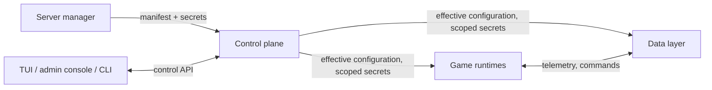

# Architecture

Valhallowed (VHD): what it is, the rules it is built under, and the decisions
still open. Terms mean exactly what [glossary.md](glossary.md) says; the name
and its rules live in [brand.md](brand.md). It describes VHD as designed; the
[board](https://github.com/orgs/valhallowed/projects/1) shows what is built.
The [diagrams](diagrams/README.md) draw it, and say how they treat a part
built short of the design.

## Target

Someone with only Docker installs a Valheim dedicated server that carries the
VHD plugin, telemetry, governed in-game commands and the web map. They write one
manifest and, optionally, a secrets file. Everything else is defaulted, derived
or generated. The host is x86-64 (§ Game facts): a Linux machine, or Docker
Desktop on Windows or macOS with an Intel or AMD processor.

## Ground rules

Decided. Each one binds every later decision. A rule keeps its number for
good, and an open decision's number is never reused. A rule settled from an
open decision names it.

| # | Rule | Why |
|---|---|---|
| G1 | **Public from the first commit.** Code, history, decisions and images are public. | Contributors see the whole record, and nothing depends on code they cannot read. |
| G2 | **No install is special.** The maintainers' own servers run the same releases, with the same settings, as everyone else's: no private code path, image, setting or override. | One product, one test surface. A setting only one install needs is a gap in the settings. |
| G3 | **Bring your own, with complete defaults.** Every external dependency has a built-in default that works with no setup, and a typed way to substitute your own. | An existing database or chat service is a setting, not a fork. |
| G4 | **Release pipeline first.** The pipeline exists and passes before any feature lands. Every feature ships through it. | Capability stays tested as features ship. |
| G5 | **Distribution:** images on a public registry (G10), the plugin as a release artifact. Builds run locally and in GitHub Actions from one definition. | Several ways to consume it, one way to build it. |
| G6 | **One way in.** Settings, secrets and operator actions enter only through the control plane and are validated there. Nothing past it reads raw input. | Validate once at the ingress. Internal logic never sees raw input, and failures stay in their own domain. |
| G7 | **License: MIT.** | The simplest terms for the people who host it and the people who contribute. Settled from O9. |
| G8 | **Name:** the product is Valhallowed, short form VHD, at valhallowed.com. | One name across code, docs and marketing. |
| G9 | **Every port, address and resource allocation is a default.** Each has a sensible default and can be changed in the manifest. That covers what meets the host: published ports, addresses, and each world's resources. Wiring inside an install, between VHD's own containers, is fixed. | Hosts differ. Defaults make the first install work; overrides make every install fit. |
| G10 | **Registry: GHCR.** Images publish to the GitHub Container Registry. | The workflow's own token publishes, so no registry secret is stored anywhere, and public images cost nothing to host or pull. Settled from O7. |
| G11 | **Identifiers.** Repos and images live in the `valhallowed` GitHub org: repo `valhallowed/valhallowed`, images `ghcr.io/valhallowed/<component>`, CLI `vhd`. | Image paths carry the owner, so they never have to change. Settled from O10. |
| G12 | **Build once, promote by tag.** Only CI on `main` builds and pushes images. A version tag applies to images already in the registry and never rebuilds them. | A release is exactly the candidate that soaked, and nothing reaches the registry from a workstation. |
| G13 | **Compose owns the containers; the running control plane holds no Docker socket.** The control plane validates, reconciles and publishes each generation; a child applies it in place, or exits and Docker restarts it under the policy Compose set. A change to the containers themselves (a world added or removed, a published port, a resource limit, the VHD version) waits as a pending change until the server manager runs `vhd apply`, which acts with the server manager's own access to Docker. | A Docker socket is root on the host, so whatever took over the control plane, or an admin console the manifest opened, would take the host with it. Container changes are rare, and they cost one host command. Settled from O1. |
| G14 | **The data layer runs as children,** one container per service, never inside the control plane. | It carries the heavy traffic and fails more often; the control plane stays small and always up. Settled from O2. |
| G15 | **One install runs many worlds,** each in its own game runtime, with its own world ports and resource limits. | A server manager with several worlds runs one install, with no extra tooling to keep several installs in step. A crash, a restart or a memory limit stays inside its world. Settled from O3. |
| G16 | **VHD builds its own game runtime image:** the supervisor, BepInEx and the plugin on a pinned base. SteamCMD and the dedicated server download into the install at first start, and the server again on each update. Neither is pinned: Valve updates SteamCMD in place, and the server is the game's newest build, which world truth guards. `lloesche/valheim-server` is a reference, not a base. | Its environment settings would be a second ingress under ours (G6), and its backups and updates duplicate control-plane work. Downloading SteamCMD keeps every Valve and Iron Gate file out of a public image. Settled from O4. |
| G17 | **One repo, one version, one CI.** Every component lives in `valhallowed/valhallowed` and ships in the same release. | Cross-component changes land together, and one version describes a release. Settled from O5. |
| G18 | **The manifest and the secrets file are TOML 1.0,** each checked against a versioned JSON Schema in [`schema/`](../schema/). Each file declares its schema version. A renamed key migrates automatically or fails with a message that names the new key. | TOML has one specification, explicit types and no meaningful indentation, so a value means what it looks like. JSON Schema is language-neutral: editors, the control plane and the settings reference read the same file. Settled from O6. |
| G19 | **Languages:** Python for the control plane, the data layer and the game runtime's supervisor; TypeScript for the web map and the admin console's front end; C# for the plugin. | One backend language, so the generation's producer and its consumers share a toolchain and its tests. The game fixes the plugin's language. Settled from O11. |

## The model

### Secrets

- **Closed key set.** The secrets schema defines every permitted key name. An
  unknown key is rejected, so a misspelt key fails at the ingress instead of
  silently doing nothing.
- **Format check per key.**
- **Optional by default.** An absent secret turns off the capability that needs
  it, and status says why. If the manifest explicitly enables a capability and
  its secret is missing, the manifest is rejected.
- **Internal secrets are generated, never asked for:** the bundled database's
  password and every service-to-service token. The server manager supplies
  only what cannot be generated: world passwords and credentials for outside
  services (chat relay, LLM provider, their own database).
- **Least privilege.** Each child receives only the secrets it needs. No child
  reads the secrets source. Status shows set, unset or invalid, never a value.
  One secret escapes this: the dedicated server takes a world's password only on
  its command line, where any user on the host can read it from the process
  list.
- **Kept apart from the manifest,** in a file of their own (G18), so the
  manifest can be committed and shared.

### Control plane

Owns ingress, reconcile, child lifecycle, operator actions and status.

- **Manifest.** Strongly typed, with a versioned schema (G18). With the secrets
  schema, it produces validation, defaults, each child's configuration and the
  user-facing settings reference, so the reference cannot drift from the code.
  Every setting records its change cost and what applies it.
- **Setting names.** Keys are snake_case. A capability's settings sit in a
  table named for it (`web_map`, `chat_relay`); a world's sit under
  `world.<save name>`. A secret's key mirrors the manifest path it belongs to
  (`world.<save name>.password`). A port is an integer; any other quantity is
  a string that carries its unit (`5s`, `6GiB`).
- **Reconcile.** The manifest, secrets and defaults produce one effective
  configuration (a generation). All or nothing: an invalid manifest on hot
  reload is rejected and the last good generation keeps running. Reconcile
  reports what was set, what defaulted and what that implies.
- **Change cost.** Every setting is classed as live, service restart or
  game-server restart. A change that needs a game-server restart waits as
  pending while players are online, unless the server manager applies it now
  after being shown which worlds and how many players it disconnects. The
  override is recorded with the change.
- **Applying a change.** The control plane publishes a generation; each child it
  affects reloads it in place, or exits and Docker restarts it. A change to the
  containers themselves waits as pending until the server manager runs
  `vhd apply` (G13): a one-shot container that only the server manager starts,
  and the only one that gets the Docker socket, for that run. It validates the
  manifest, keeps a game-server restart pending while players are online unless
  the server manager confirms it, renders the install's compose file from the
  current generation and the release's `compose.yaml`, and has Compose recreate
  only the containers whose definition changed. `vhd apply --disconnect-players`
  is that confirmation. A world whose runtime has stopped reporting counts as
  occupied, since status cannot vouch for it. A player who joins in the seconds
  between that check and Compose recreating a container is disconnected; a
  change a runtime applies in place has no such window. The Compose it runs is
  the one in the control plane's image, so the host's own Compose only has to
  start the one-shot.
- **Delivering a generation.** The control plane writes each child's
  generation, and the secrets scoped to it, into that child's own directory of
  one generations volume. The directory, like the child's Compose service, is
  named for it: a world's save name in lower case with a short hash, since
  save names allow characters Compose names do not. Each child mounts only its
  own directory, read-only (a volume subpath, which needs Docker Engine 26), so
  it can read no other child's secrets. The secrets go first and the generation
  second, and a child acts on neither until both carry the same generation
  (B1). A world's directory is also keyed by its port, so when `vhd apply`
  moves a world to a new port only the new container reads that change. If
  Compose fails partway, `vhd apply` brings the install back on the compose
  file Compose last ran successfully, which it replaces only once a run
  succeeds; a moving world's old directory stays as it was until then.
- **Running as.** The control plane runs as the install folder's owner, whom
  `vhd apply` reads from the folder, so the secrets file can stay readable by
  its owner alone. Every other child runs as VHD's own unprivileged user.
- **Host check.** At first start and on every reconcile, the control plane
  compares what the manifest asks for with what the host has: ports, memory
  and CPU per world, disk for worlds and backups. A shortfall is a warning in
  status, never a silent failure. A port already taken on the host stops only
  the world that needs it.
- **Interfaces.** One control API. The TUI, the admin console and the CLI,
  `vhd`, are its clients, and cover manifest errors, hot reload, status, world
  import and export, backups and logs. The CLI runs from the control plane's
  image, so a host needs only Docker. The control API answers on a Unix socket
  in a volume only the control plane and `vhd` mount, so no child and no network
  reaches it. Children report status to a separate listener on the install
  network that accepts status and nothing else, and only from the reporting
  world's own container: it trusts source addresses, which holds because no
  child has the capability to forge one. The admin console will put the control
  API on the host's loopback unless the manifest opens it, once its
  authentication is settled (O14).
- **Failure domain.** Needed to start or change an install, not to keep it
  running. If it stops at steady state, children keep running on the last good
  generation.
- **Status reports world truth, not container health:** whether the world
  loaded, and its object count against the save. A world whose runtime has not
  reported for three of its reporting intervals shows as unknown, never as its
  last state.

### Game runtimes

- **The child runs the game; the control plane sets policy.** A runtime runs
  the Valheim dedicated server, BepInEx and the plugin on what the control
  plane hands it; its supervisor reads the generation, installs and updates
  the server, starts and stops it, and reports status. Updates, backups,
  schedules, and world import and export belong to the control plane. Until
  the control plane sets an update policy, the supervisor updates the server
  at every start, and world truth holds a world the update stops from loading.
  Each world downloads and updates a server of its own, so a crash, an update
  or a full disk stays inside it; worlds on one host pay that disk space and
  download once each.
- **Restart gating is shared.** The control plane keeps a change pending while
  status shows players, and the runtime makes the final check when it would
  restart the game, since only it sees the count at that moment: it restarts
  only for a current count of no players, or for a generation that carries the
  server manager's confirmation (B1). Only that confirmation, or a stop, ends a
  world that is still loading, and then by a kill, which saves nothing.
- **Children read only the effective configuration.** Generated files, such as
  the plugin's BepInEx config, are never edited by hand.
- **World truth gates saving.** A world that fails world truth is stopped
  before its first autosave, so an empty world never saves over the real one,
  and status says why. Until a save parser can count a save's objects, world
  truth compares the plugin's count with what the runtime last saw the world
  hold: a world that held objects, or had a save and no count, fails when it
  loads empty or when the plugin never reports it.
- **Hold.** An action that replaces a world's files, such as import or
  restore, puts its runtime on hold: the game stops and the container stays
  up until the action finishes. No Docker socket is needed (G13).
- **Capabilities are independent.** Telemetry, in-game commands, chat relay,
  assistant, web map and sign-in each switch on separately and declare what
  they depend on. A failure in one degrades that capability only.

### Data layer

Telemetry intake, persistence, the command broker, the chat relay, the web map
and the database, each service a child in its own container (G14). Three rules
hold: only the broker creates a command, only the plugin executes one, and
markers and journal entries are records, never commands.

### Internal boundaries

The ingress is the one way in from outside. Every crossing inside VHD is a
boundary, and every boundary follows one standard. Each contract lives in
[`contracts/`](../contracts/), with valid and invalid examples.

- One typed contract, versioned with the release, with a contract test in the
  pipeline.
- The receiving side validates.
- One owner.
- A stated failure behaviour. Observations fail soft: drop and count, and the
  game never waits. Actions fail closed: refuse and record.

| # | Boundary | Crosses | Contract | On failure |
|---|---|---|---|---|
| I0 | Ingress | Manifest, secrets, operator actions into the control plane | Manifest schema, secrets schema, control API | Reject whole; the last good generation keeps running |
| B1 | Control plane → children | Effective configuration and scoped secrets; status back | Generation schema | The child keeps its last good generation |
| B2 | Plugin → intake | Telemetry events | Event schema | Fail soft |
| B3 | Broker ↔ plugin | Commands and their outcomes | Command verbs, limits, idempotency key | Fail closed |
| B4 | Services → database | Reads and writes | Schema owned by the data layer; one role per service | The capability degrades; nothing else migrates the schema |
| B5 | Plugin → world render | Map export file | Export file format | The web map keeps its last good render |
| B6 | Web map → data | Reads, record writes, chat sends | Read-only role, record constraints, chat-scoped token through the broker | The web map stays read-only |
| B7 | Assistant → LLM provider | World digest and question; answer | Provider adapter with timeout and budget | The assistant reports itself unavailable |
| B8 | Chat relay ↔ chat service | Events out; commands in | Adapter; inbound authors allow-listed; commands go through the broker | The relay switches off; the game is unaffected |
| B9 | Web map ↔ Steam | Sign-in | OpenID; server-side sessions | The web map stays public and read-only |
| B10 | Players → game runtime | Game traffic and chat lines | Game protocol (not ours); chat commands parsed and rate-limited by the plugin, issued through the broker | The command is refused and audited |
| B11 | Players → web map | Web requests | Web map API schema; identity from the session only | The request is rejected |

### Exposure

An exposure profile sets what an install opens beyond the host. Every port and
address in a profile is a default (G9).

| Profile | Game | Web map | Sign-in |
|---|---|---|---|
| LAN (default) | Reachable | Plain HTTP on the LAN | Works for LAN players; warns that sessions are unencrypted |
| Public, direct | Open to the internet | Plain HTTP, open to the internet | Works for everyone; same warning, plus a browser warning on a player's first visit |
| Public with TLS | Open to the internet | HTTPS through bundled TLS or the server manager's own proxy (O12) | Works for everyone, with no warnings |
| Game only | Reachable | Off | Off |

In every profile the admin console stays on loopback unless the manifest opens
it, and no data-layer service or database gets a host port.

Whether what a profile opens reaches the internet is up to the host's network:
behind a home router it takes a port forward, and on a server with its own
public address everything the LAN profile opens is public unless a firewall
closes it.

## Lanes

Follows from G2 and G4. Building VHD, developing it and running it can share one
host without touching each other. The registry is the line between building
the product and running it.

| Lane | Runs | Isolation |
|---|---|---|
| Build | Source to plugin artifact and images | No running state |
| Dev | A full install of the product with a throwaway world, including its own game server for plugin work | Its own install: project name, network, volumes and ports. Never touches a consumer install |
| Consumer | Released tags pulled from the registry, nothing else | A normal install |

## Releases

Follows from G4 and G12.

| Channel | Image tags | Made by |
|---|---|---|
| Commit | `sha-<short commit>`, `edge` | Every merge to `main`: CI builds and pushes the images |
| Candidate | `X.Y.Z-rc.N` | Tag `vX.Y.Z-rc.N`: promotes that commit's images |
| Release | `X.Y.Z`, `latest` | Tag `vX.Y.Z`: promotes the newest candidate on the same commit, and is refused if there is none |

- **Images record the commit they were built from.** Versions exist only as
  tags, which is what lets a tag promote an image without rebuilding it.
- **Acceptance installs from the registry.** A clean runner installs a
  channel's images anonymously and checks that the install works. An image
  that was never pushed, or is not public, fails there, not on someone's
  server. It runs on every commit build, and again on the images a version tag
  promotes, before the tag moves them.
- **The nightly game check** builds and accepts the newest commit against the
  newest game build, because game patches arrive without notice. A candidate
  needs a recent pass. Beside it, the pinned downloads Dependabot cannot
  watch are compared with their newest releases; a newer one opens an issue and
  blocks nothing, since a game-patch fix must not wait on an unrelated bump.
- **Candidates and releases attach** `compose.yaml`, with every image pinned by
  digest, the manifest and secrets schemas, the plugin artifact and
  `SHA256SUMS`. Release notes name the game build the release was accepted on.
- **Three gates.** The merge gate: every check passes before a merge to
  `main`. The candidate gate: acceptance passes on the registry images,
  including against the newest game build, before a candidate tag. The release
  gate: the candidate ran on the candidate channel with no open blockers before
  the release tag.

## Delivery order

1. **Charter.** Settle the decisions that shape the walking skeleton (G13–G19)
   and the first version of the manifest schema.
2. **Pipeline and walking skeleton.** Build, publish, install from the registry
   on a clean host, and see one live player on the web map. The walking
   skeleton runs on built-in defaults.
3. **Acceptance material.** Recorded sessions, world saves and contracts that
   every capability must keep, synthesized or anonymized.
4. **Capabilities, one release at a time,** each passing its acceptance
   material and each shipping with its bring-your-own settings (G3).

## Game facts

What any design here must respect about the game.

- The dedicated server ships for x86-64 only, so every VHD image is
  `linux/amd64`. An ARM host is not supported.
- Two save formats are live: a single pre-1.0 file and the 1.0+ chunked
  directory. Save numbers wrap; the game picks the newest by modification time.
- The server loads the save its world setting names. When no save has that
  name, or the save fails to load, the server creates a new, empty world under
  the name, and writes that world's small `_main.0.fwl2` into the save's
  directory before any plugin loads; recovering a held world removes it.
- A new world counts no objects when it first loads, and its real count about
  30 seconds later. A world loaded from a save counts its objects at once.
- A world's server uses its port and the next one, over UDP; the server's own
  start script asks for its port through port+2 to be forwarded. Worlds that
  share a host need ranges that do not overlap.
- The server lists itself publicly unless told not to. A listed server refuses
  to start unless its password has at least five characters and is not part of
  the world's name or seed.
- Harmony binds patches by name. After a game patch, a patch can apply and then
  throw, so a healthy container does not mean a loaded world.
- Player names are client-supplied and not unique. Identity comes only from
  same-object pairs (beds, tombstones, wards).
- Prefab names must be verified against live world data, never assumed.
- A save parser fails closed outside the version range it was validated
  against.
- The plugin builds against stock, unmodified game assemblies plus BepInEx and
  Harmony, with no publicizer step. The dedicated-server download carries every
  game assembly it references (`assembly_valheim`, `UnityEngine`,
  `UnityEngine.CoreModule`), so a build stage fetches them and the plugin
  builds anywhere, including GitHub Actions. Game files never enter
  an image or a release.

## Open decisions

A number missing from this table was settled as a ground rule, which names it,
or withdrawn.

| # | Question | Options | Lean |
|---|---|---|---|
| O12 | TLS for a public web map | Plain HTTP with warnings · bundled TLS with automatic certificates, for a hostname or a bare public IP · the server manager's own reverse proxy | Offer all three. Bundled TLS is the recommended public profile: Let's Encrypt has issued six-day certificates for bare IP addresses since January 2026, so it needs no domain, only port 80 or 443 reachable for the challenge. |
| O13 | Default resources per world | Fixed defaults · sized from the host at first start | Fixed defaults, set from a measurement under player load. One idle-hours reading put a game server at 1.9–2.8 GiB of memory. The host check warns when the host falls short. |
| O14 | Authenticating the admin console to the control API | A generated token the console asks for · Steam sign-in limited to the server manager · loopback with no authentication | A generated token, kept in the control plane's volume and printed by `vhd`. Loopback alone lets any user on the host act as the server manager. |
